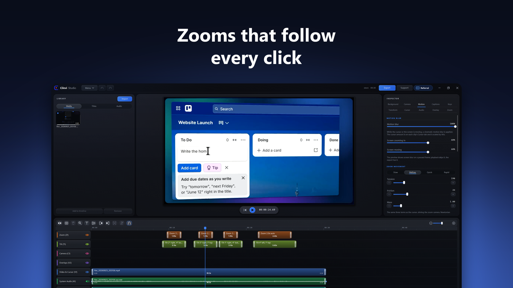

# Cilevi

Cilevi is a screen recorder and video editor for Windows. You record a take, and the Studio opens with it already edited: the picture zooms in on your clicks and stays in while you type, the pointer moves smoothly, and the recording sits on a background in a rounded frame. From there you can add captions, a camera, titles and sound, then export an MP4 or a GIF.

Recording, editing, captions and export all run on your own computer. Nothing you record is uploaded, and you do not need an account.

## What it runs on

- Windows 10 or 11, 64 bit.
- A graphics card is optional. Export uses it when there is one and the processor when there is not.
- Captions are written on your computer in 99 languages, which needs a processor with AVX2 (most have it).

Cilevi for Mac is finished and waiting for Apple's review. It will be in the Mac App Store, for macOS 15 or later, and this page will say so when it is.

## Price and where to get it

Install Cilevi from the [Microsoft Store](https://apps.microsoft.com/detail/9NB07ZW49F3D). The install is free and the app is complete for seven days, with every feature and no watermark. The Store keeps it updated.

To keep using it after that, buy a licence key on [cilevi.com](https://cilevi.com/buy): 50 US dollars, once. There is no subscription. Your key covers every update to version 2. The checkout is run by Paddle, which adds your country's sales tax or VAT and shows it before you pay. A key bought on the site is refunded in full if you ask within 14 days ([refund policy](https://cilevi.com/refunds)).

Download page: [cilevi.com/download](https://cilevi.com/download). Pricing: [cilevi.com/pricing](https://cilevi.com/pricing).

## Help and feedback

- **Found a bug?** [Open an issue](https://github.com/cilevi/cilevi/issues/new/choose). [docs/support.md](docs/support.md) says what makes a report easy to fix.
- **A question, or an idea?** Ask in [Discussions](https://github.com/cilevi/cilevi/discussions), or vote on the [feedback board](https://cilevi.com/feedback).
- **Rather write to a person privately?** [cilevi.com/support](https://cilevi.com/support) or support@cilevi.com.
- **How do I...?** The [guide](https://cilevi.com/guide) has 70 short articles, one for each part of the app.
- **New to Cilevi?** [docs/getting-started.md](docs/getting-started.md) takes you from install to your first exported video.
- **What changed in each version:** [docs/release-notes.md](docs/release-notes.md).
- **A security problem:** please do not post it in public. See [SECURITY.md](SECURITY.md).

## About this repository

This repository holds the release notes, bug reports and questions for Cilevi. It does not hold the source code.

Cilevi is made by Doment Digital FZE LLC, Sharjah, United Arab Emirates. [cilevi.com](https://cilevi.com)
